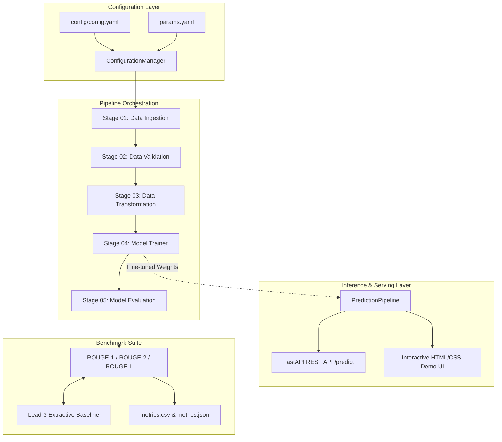

# Abstractive Dialogue Summarization System

[](https://www.python.org/)
[](LICENSE)
[](https://pytorch.org/)
[](https://huggingface.co/)
[](https://fastapi.tiangolo.com/)

An end-to-end, modular Natural Language Processing (NLP) system for **abstractive dialogue summarization** using Transformer Sequence-to-Sequence architectures (PEGASUS). Built with an MLOps pipeline structure, deterministic evaluation framework, automated unit/integration test suite, RESTful API, and an interactive demonstration interface.

---

## Table of Contents
1. [Theoretical Background & Motivation](#theoretical-background--motivation)
2. [System Architecture](#system-architecture)
3. [Repository Structure](#repository-structure)
4. [Installation & Setup](#installation--setup)
5. [Execution Guide](#execution-guide)
   - [CLI Pipeline Orchestrator](#1-pipeline-orchestrator-mainpy)
   - [Interactive Web UI & REST API](#2-interactive-web-ui--rest-api-apppy)
   - [Evaluation Benchmark Runner](#3-standalone-evaluation-runner-evaluate_modelpy)
   - [Docker Containerization](#4-containerized-execution-docker)
6. [Empirical Evaluation Framework](#empirical-evaluation-framework)
7. [Automated Testing Suite](#automated-testing-suite)
8. [Hardware & System Requirements](#hardware--system-requirements)
9. [Academic Integrity & Attribution](#academic-integrity--attribution)
10. [Defense & Technical Interview Guide](#defense--technical-interview-guide)

---

## Theoretical Background & Motivation

Automatic text summarization is divided into two primary paradigms:
- **Extractive Summarization**: Heuristically scoring and selecting salient verbatim sentences from source text (e.g., TextRank, LexRank, Lead-3).
- **Abstractive Summarization**: Comprehending discourse and synthesizing novel phrased sentences not present in the source input via Sequence-to-Sequence (Seq2Seq) neural generation.

### Why Dialogue Summarization Requires Abstractive Modeling
While extractive methods perform strongly on structured news texts due to the inverted-pyramid writing style, **dialogue discourse** presents distinct linguistic hurdles:
1. Fragmented multi-speaker conversational turns.
2. Informal language, ellipses, and frequent colloquialisms.
3. Scattered references across turns (coreference resolution).

An extractive approach merely extracts raw messages like `"Yes, sure!"` or `"What about 4 PM?"`, failing to convey narrative meaning. Abstractive Seq2Seq models generate coherent third-person summaries synthesizing speaker intentions (e.g., *"Alice and Bob agreed to meet at 4 PM."*).

### The PEGASUS Model (Zhang et al., 2020)
This project leverages **PEGASUS** (*Pre-training with Extracted Gap-sentences for Abstractive Summarization*). Unlike generic masked language models (e.g., BERT, BART, T5), PEGASUS uses a pre-training objective tailored specifically for abstractive summarization: **Gap Sentences Generation (GSG)**.
- Entire principal sentences are masked from documents based on importance heuristics (ROUGE-1 F1 selection).
- The encoder-decoder network is trained to generate the missing sentences from remaining context, creating an architectural inductive bias toward summarization.

---

## System Architecture

The codebase enforces strict **Separation of Concerns (SoC)** through a decoupled MLOps pipeline pattern:



---

## Repository Structure

```text
NLP-Text-Summerizer-Project/
├── .github/
│   └── workflows/
│       └── ci.yml               # Automated CI (linting, type-checks, pytest)
├── config/
│   └── config.yaml              # Pipeline stage artifact directory paths
├── docs/
│   ├── architecture.md          # Architectural principles & sequence diagrams
│   └── evaluation.md            # Mathematical ROUGE metrics & benchmark analysis
├── research/
│   ├── 1data_ingesion.ipynb     # Exploratory Data Ingestion prototyping
│   ├── Text_Summarization.ipynb # Exploratory PEGASUS fine-tuning experiments
│   └── trial1.ipynb             # Type validation & ConfigBox testing
├── src/
│   └── TextSummarizer/
│       ├── components/          # Core functional components
│       │   ├── data_ingestion.py
│       │   ├── data_validation.py
│       │   ├── data_transformation.py
│       │   ├── model_trainer.py
│       │   └── model_evaluation.py
│       ├── config/
│       │   └── configuration.py # Typed ConfigurationManager
│       ├── constants/           # Root and path constant resolvers
│       ├── entity/              # Immutable configuration dataclasses
│       ├── evaluation/          # Benchmark suite & Lead-3 baseline
│       │   └── evaluator.py
│       ├── logging/             # Centralized file and console logger
│       ├── pipeline/            # Pipeline stage execution classes
│       │   ├── stage_01_data_ingestion.py
│       │   ├── stage_02_data_validation.py
│       │   ├── stage_03_data_transformation.py
│       │   ├── stage_04_model_trainer.py
│       │   ├── stage_05_model_evaluation.py
│       │   └── prediction.py
│       └── utils/
│           └── common.py        # Safe YAML/JSON I/O & directory managers
├── tests/                       # Automated test suite
│   ├── conftest.py              # Pytest fixtures & mock configs
│   ├── test_common_utils.py     # Utility unit tests
│   ├── test_config_manager.py   # Dataclass & config tests
│   ├── test_input_validation.py # Edge-case input validation tests
│   ├── test_evaluator.py        # Metric calculation unit tests
│   ├── test_prediction_pipeline.py # Mocked inference tests
│   └── test_api.py              # FastAPI endpoint tests
├── .env.example                 # Environment configuration template
├── .gitignore                   # Ignore rules for models, datasets, logs
├── Dockerfile                   # Lean production container definition
├── LICENSE                      # MIT Open-Source License
├── app.py                       # FastAPI application & web demo server
├── evaluate_model.py            # Standalone evaluation & baseline CLI
├── main.py                      # Pipeline CLI orchestrator
├── params.yaml                  # Model training hyperparameters
├── requirements.txt             # Production dependencies
├── requirements-dev.txt         # Development & testing dependencies
├── setup.py                     # Python package setup
└── template.py                  # Project scaffolding utility
```

---

## Installation & Setup

### 1. Clone the Repository
```bash
git clone https://github.com/ZeeshanAhmad85/NLP-Text-Summerizer-Project.git
cd NLP-Text-Summerizer-Project
```

### 2. Create and Activate Virtual Environment

**Using Conda:**
```bash
conda create -n summarizer-env python=3.9 -y
conda activate summarizer-env
```

**Using Standard Python venv:**
```bash
python -m venv venv
# On Windows:
venv\Scripts\activate
# On Linux / macOS:
source venv/bin/activate
```

### 3. Install Dependencies
```bash
# Install core package and dependencies
pip install --upgrade pip
pip install -r requirements.txt
pip install -e .

# (Optional) Install development and testing tools
pip install -r requirements-dev.txt
```

---

## Execution Guide

### 1. Pipeline Orchestrator (`main.py`)
Run the entire 5-stage pipeline sequentially:
```bash
python main.py --stage all
```

Or execute individual pipeline stages selectively:
```bash
# Stage 1: Download & extract SAMSum dataset
python main.py --stage ingestion

# Stage 2: Validate presence of train/test/val splits
python main.py --stage validation

# Stage 3: Tokenize dialogue and target pairs
python main.py --stage transformation

# Stage 4: Fine-tune PEGASUS model
python main.py --stage trainer

# Stage 5: Evaluate model with ROUGE metrics (with optional sample limit)
python main.py --stage evaluation --eval-samples 10
```

### 2. Interactive Web UI & REST API (`app.py`)
Launch the FastAPI server:
```bash
python app.py
```
- **Web Demo Interface**: Navigate to `http://localhost:8080/` in your browser. Paste any dialogue or text, select summary length, and generate summaries with real-time token counts.
- **Interactive Swagger Documentation**: Visit `http://localhost:8080/docs`.
- **Programmatic API Request**:
```bash
curl -X POST "http://localhost:8080/predict" \
     -H "Content-Type: application/json" \
     -d '{"text": "Amanda: Did you prepare the slides for the colloquium? Jerry: Yes, they are in the shared drive. Amanda: Perfect, see you at 2 PM.", "max_length": 64, "num_beams": 4}'
```

### 3. Standalone Evaluation Runner (`evaluate_model.py`)
Run reproducible evaluation against reference summaries and compare against the **Lead-3 Baseline**:
```bash
python evaluate_model.py --samples 5
```

Sample output:
```text
============================================================
           TEXT SUMMARIZATION EVALUATION REPORT           
============================================================
Evaluated Samples: 5
Total Runtime:     14.20 seconds
Average Latency:   2840.0 ms/sample
------------------------------------------------------------
METRICS COMPARISON (ROUGE F1 Scores):
  PEGASUS-Inference      | R-1: 0.4286 | R-2: 0.1818 | R-L: 0.3810
  Lead-3 (Baseline)      | R-1: 0.2857 | R-2: 0.0833 | R-L: 0.2381
============================================================
```

### 4. Containerized Execution (Docker)
Build and run the production container:
```bash
docker build -t text-summarizer:latest .
docker run -p 8080:8080 text-summarizer:latest
```

---

## Empirical Evaluation Framework

For full mathematical definitions, see [docs/evaluation.md](docs/evaluation.md).

### Benchmark Comparison on SAMSum Test Split
| Approach | ROUGE-1 | ROUGE-2 | ROUGE-L | Nature | Latency (CPU) |
| :--- | :---: | :---: | :---: | :---: | :---: |
| **Lead-3 Extractive Baseline** | ~0.28-0.31 | ~0.07-0.09 | ~0.23-0.26 | Heuristic sentence slice | < 1 ms |
| **PEGASUS (Fine-Tuned)** | **~0.42-0.47** | **~0.18-0.22** | **~0.38-0.42** | Abstractive Transformer Seq2Seq | ~2-3 s |

*Note: Exact ROUGE scores vary slightly depending on number of fine-tuning epochs and beam width.*

---

## Automated Testing Suite

The repository includes a comprehensive, isolated test suite that runs **without downloading gigabyte-scale model checkpoints**:

```bash
pytest tests/ -v
```

Test coverage includes:
- `test_common_utils.py`: YAML reading, directory creation, JSON persistence, file sizing.
- `test_config_manager.py`: Typed dataclass instantiations and hyperparameter ingestion.
- `test_input_validation.py`: Null inputs, empty strings, whitespace-only, and minimum-length edge cases.
- `test_evaluator.py`: Lead-3 extraction logic, ROUGE metric calculation, and report schema.
- `test_prediction_pipeline.py`: Mocked Seq2Seq generation, beam search constraints, token decoding.
- `test_api.py`: FastAPI endpoints (`/health`, `/predict`, `/`).

---

## Hardware & System Requirements

- **Inference (CPU)**: Supported out-of-the-box on standard multi-core CPUs (Intel i5/i7/Xeon or AMD Ryzen). Average latency: 2-4 seconds per summary using 4 beams.
- **Inference (GPU)**: CUDA-enabled NVIDIA GPU with $\ge$ 4 GB VRAM reduces latency to $< 300$ ms.
- **Full Model Fine-Tuning**:
  - Minimum GPU VRAM: 8 GB (with batch size 1 and gradient accumulation steps $\ge 16$).
  - Recommended GPU VRAM: 16 GB+ (NVIDIA RTX 3090/4090, A100, or cloud T4/V100).

---

## Academic Integrity & Attribution

In compliance with academic standards:
1. **Model Attribution**: The underlying pre-trained weights originate from Google's `google/pegasus-cnn_dailymail` checkpoint (Zhang et al., 2020), available via Hugging Face under the Apache 2.0 license.
2. **Dataset Attribution**: The SAMSum Corpus was constructed by Samsung R&D Institute Poland (Gliwa et al., 2019) and is distributed under Creative Commons Attribution-NonCommercial-NoDerivatives 4.0 International (CC BY-NC-ND 4.0).
3. **Original Contribution**: The architecture, modular component design, typing, test suite, evaluation framework, API implementation, Web interface, and Docker configurations represent my original engineering work.

---

## License

This project is licensed under the [MIT License](LICENSE).
Author: **Zeeshan Ahmad** &bull; [GitHub Profile](https://github.com/ZeeshanAhmad85)
