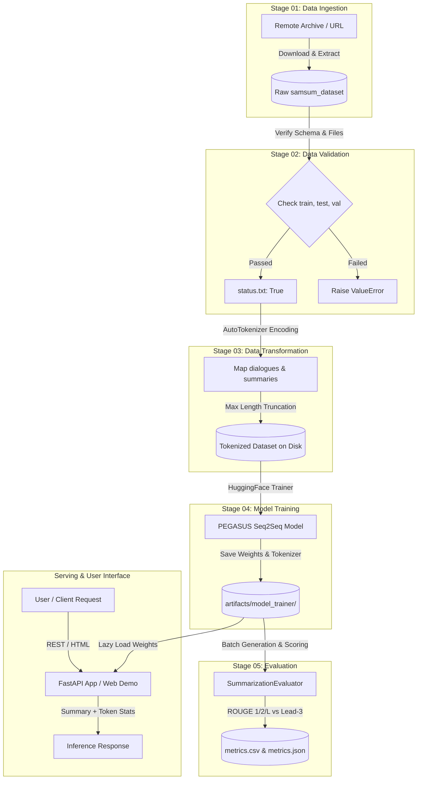

# Architecture & System Design

This document details the software engineering architecture and machine learning pipeline design of the **NLP Text Summarization System**.

---

## 1. Architectural Principles

The repository adheres to the **Separation of Concerns (SoC)** principle and modular pipeline patterns, decoupling configuration, data manipulation, model lifecycle, and interface layers:

1. **Configuration Decoupling (`config/` & `params.yaml`)**:
   - Pipeline hyperparameters (learning rate, epochs, batch sizes, warmup steps) are separated from pipeline orchestration paths.
   - All runtime entities are instantiated into immutable, strongly typed dataclasses (`DataIngestionConfig`, `DataValidationConfig`, `ModelTrainerConfig`, etc.).

2. **Isolated Functional Components (`src/TextSummarizer/components/`)**:
   - Each phase of the MLOps lifecycle is encapsulated in an independent, single-responsibility component.
   - Components accept solely validated configuration objects, ensuring stateless execution and isolated testability.

3. **Sequential Pipeline Orchestration (`src/TextSummarizer/pipeline/`)**:
   - Each pipeline stage (`stage_01_data_ingestion.py` through `stage_05_model_evaluation.py`) is structured as an executable script and class.
   - `main.py` provides central CLI execution, logging, and error tracing.

4. **Inference & Serving Layer (`app.py` & `src/TextSummarizer/pipeline/prediction.py`)**:
   - Lazy-loading of PyTorch neural weights and tokenizers to minimize cold-start latency.
   - Validation boundaries protecting models against null, empty, whitespace-only, and excessively short/malformed inputs.
   - Dual interface: OpenAPI-documented RESTful JSON API (`/predict`, `/health`) and interactive Web UI demonstration.

---

## 2. Pipeline Stage Breakdown

---

## 3. Data Flow & Tensor Processing

### Preprocessing & Tokenization
- **Dialogue Input Sequence**: Up to 1024 tokens processed through the PEGASUS SentencePiece / Unigram tokenizer. Sequences exceeding 1024 tokens are truncated with attention masks generated accordingly.
- **Summary Target Sequence**: Maximum 128 tokens for abstractive targets.
- **Data Collator**: `DataCollatorForSeq2Seq` dynamically pads model inputs and labels within each micro-batch to minimize wasted memory.

### Optimization & Hyperparameters
- **Base Architecture**: Pre-trained PEGASUS (`google/pegasus-cnn_dailymail`) utilizing Gap Sentence Generation (GSG) pretraining objectives.
- **Gradient Accumulation**: Set to 16 micro-steps to simulate an effective batch size of 16 on resource-constrained consumer GPUs or CPU memory.
- **Inference Beam Search**: Default width $k=4$, length penalty $\alpha=0.8$ with early stopping enabled.
